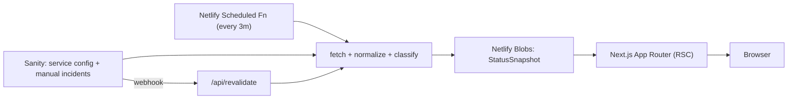

# Last Rev Services Status

A fast, high-clarity status dashboard for the third-party services Last Rev depends on.
It answers "is anything broken or degraded right now?" at a glance, surfaces active
incidents, and shows scheduled maintenance without letting it overwhelm the service health view.

- **Live:** https://lr-status-page.netlify.app (→ status.lastrev.com after cutover)
- **Studio:** https://lr-status-page.netlify.app/studio
- **Status API:** https://lr-status-page.netlify.app/api/status

## Architecture



- **Next.js 16 (App Router) + React 19 + TypeScript** on **Netlify** (OpenNext plugin).
- **Sanity** is the source of truth for service config, categories, settings, and manual incidents.
- A **Netlify Scheduled Function** polls all feeds every ~3 minutes, normalizes them, and writes a
  single snapshot to **Netlify Blobs**. The page reads that snapshot (no per-request fan-out to 20+
  upstream status pages). If no Blob exists (local dev / cold start) it computes on demand.
- **MUI v9** dark theme; Server Components by default with minimal client JS for filters/accordions.

### Status model

Feeds (RSS/Atom, Atlassian Statuspage, Heroku API, manual) are normalized into a typed
`StatusSnapshot` (`src/lib/status/types.ts`). Color is never the only signal — every state pairs a
color with an icon and label.

| Tone                | Meaning                                            |
| ------------------- | -------------------------------------------------- |
| Green (operational) | No recent incident, no active maintenance          |
| Yellow (degraded)   | Incident within the recent window (default 24h)    |
| Red (outage)        | Active outage or very recent incident (default 3h) |
| Blue (maintenance)  | Scheduled or active maintenance                    |
| Gray (unknown)      | Disabled, no data, or feed fetch failed            |

## Prerequisites

- **Node 24 LTS** (`.nvmrc` → `nvm use`)
- **pnpm 11** (via Corepack: `corepack enable`)

## Local development

```bash
nvm use            # Node 24
corepack enable    # pnpm 11
pnpm install
cp .env.example .env   # then fill in the values (see below)
pnpm dev               # http://localhost:3000  (Studio at /studio)
```

### Environment variables

| Variable                         | Scope  | Purpose                                                   |
| -------------------------------- | ------ | --------------------------------------------------------- |
| `NEXT_PUBLIC_SITE_URL`           | public | Canonical URL, OG tags, sitemap, robots                   |
| `NEXT_PUBLIC_SANITY_PROJECT_ID`  | public | Sanity project (`512px0vg`)                               |
| `NEXT_PUBLIC_SANITY_DATASET`     | public | Sanity dataset (`production`)                             |
| `NEXT_PUBLIC_SANITY_API_VERSION` | public | Sanity API version                                        |
| `SANITY_READ_TOKEN`              | server | Read token (dataset is private); also used by `pnpm seed` |
| `SANITY_REVALIDATE_SECRET`       | server | Guards `/api/revalidate` (Sanity webhook)                 |
| `ALLOWED_FEED_HOSTNAMES`         | server | Optional comma-separated SSRF allowlist additions         |

> `NEXT_PUBLIC_*` values are inlined at **build time** — changing them on Netlify requires a rebuild.

## Scripts

| Command                     | Description                                                                              |
| --------------------------- | ---------------------------------------------------------------------------------------- |
| `pnpm dev`                  | Dev server                                                                               |
| `pnpm build` / `pnpm start` | Production build / serve                                                                 |
| `pnpm typecheck`            | `tsc --noEmit`                                                                           |
| `pnpm lint`                 | ESLint (flat config)                                                                     |
| `pnpm test`                 | Vitest unit tests (classification, normalization, fetchers, snapshot)                    |
| `pnpm test:e2e`             | Playwright smoke tests (needs a build; run `pnpm exec playwright install chromium` once) |
| `pnpm seed`                 | Seed Sanity with categories + services from `src/lib/status/config.ts`                   |
| `pnpm format`               | Prettier                                                                                 |

## Sanity

- **Studio** is embedded at `/studio` (noindex, behind Sanity auth). No separate `sanity deploy` needed.
- **Schemas:** `statusPageSettings`, `statusCategory`, `statusService`, `manualIncident`
  (`src/sanity/schemaTypes`).
- **Editors** can add/remove/hide/pin/categorize services, set manual overrides, post manual
  incidents/maintenance, and edit settings + the announcement banner — no code changes.
- **Seeding:** `pnpm seed` (idempotent; uploads logos from `/public/images`). Requires a write token.
- **CORS:** the embedded Studio needs each host added under Sanity → Manage → API → CORS Origins
  (`localhost:3000`, the Netlify URL, and `status.lastrev.com` are configured).
- **Instant updates:** a Sanity webhook posts to `/api/revalidate?secret=…`, which refreshes the
  snapshot so edits appear in seconds (otherwise the 3-min schedule picks them up).

## Netlify

- Build: `pnpm build` with `@netlify/plugin-nextjs`; `NODE_VERSION = 24` (`netlify.toml`).
- `netlify/functions/update-status.ts` runs on a 3-minute schedule and writes the snapshot to Blobs.
- Security headers + CSP and `/studio` + `/api` noindex are set in `next.config.ts` `headers()`
  (so they apply to SSR responses, which `netlify.toml` headers do not).
- Set the env vars above in Site settings → Environment variables, then trigger a rebuild.

## Project structure

```
app/                     # App Router routes (page, api/status, api/revalidate, robots, sitemap, studio)
src/lib/status/          # types, config/seed, fetchers, classify, normalize, sanitize, snapshot, cache
src/lib/sanity/          # client + GROQ queries
src/sanity/schemaTypes/  # Sanity schemas
src/components/status/   # dashboard UI
src/theme/               # MUI theme + tokens
netlify/functions/       # scheduled aggregator
scripts/seed-sanity.ts   # seeding
```

## Troubleshooting

- **Page shows seed data / `/images` logos instead of Sanity:** the deploy was built before env vars
  were set, or the dataset is unreachable. Set env vars and trigger a rebuild.
- **Studio won't log in:** add the origin under Sanity → Manage → API → CORS Origins (with credentials).
- **A service is missing/extra incidents:** tune that service's `ignoreTitlePatterns` /
  `maintenanceKeywords` / `noIncidentPatterns` in Studio. Disabled services are excluded entirely;
  hidden services are fetched but not shown.
- **Stale data on prod:** the page serves the cached Blob (refreshed every 3 min). Trigger
  `/api/revalidate` (or edit in Studio) to refresh immediately.

## Cutover (Heroku → Netlify)

1. Verify the Netlify deploy + scheduled refresh + Studio edits.
2. Point `status.lastrev.com` DNS at Netlify; keep the Heroku app running until verified.
3. Decommission Heroku once traffic is confirmed on Netlify.

<!-- BWS-SECURE-DOCS-START -->
## 🔒 BWS Secure Environmental Variable Integration

This project uses [BWS Secure](https://github.com/last-rev-llc/bws-secure) for managing environment variables across different environments.

### 🔐 Creating an Access Token

📍 **1.** Visit the [Bitwarden Machine Accounts](https://vault.bitwarden.com/#/sm) section within your Vault.
   - If you login directly to https://vault.bitwarden.com, you will need to navigate to the Machine Accounts section, within the Secrets Manager. The Secrets Manager is located in the left sidebar, typically at the bottom of the page.
   - If you don't have access, please refer to the [BWS Secure documentation](https://github.com/last-rev-llc/bws-secure) or contact your team administrator

🖱️ **2.** Navigate to the Machine Accounts section, and follow these steps:
   - Select the appropriate Client/Set of Machine Accounts from the list
   - Click on the "Access Tokens" tab
   - Click "+ New Access Token" button
   - Give the token a meaningful name (e.g., "Your Name - Local Development")
   - Click "Save" to generate the token

📋 **3.** Copy the displayed token (you won't be able to see it again after closing)

💾 **4.** Add it to your .env file in your project root:
   ```
   BWS_ACCESS_TOKEN=your_token_here
   ```

⚠️ **5.** Never commit this token to version control

### 🎯 Token and project options

- **BWS_ACCESS_TOKEN**: Required to load secrets from Bitwarden (scoped to your machine account).
- **BWS_PROJECT_ID** (optional): Restrict to one or more BWS **project UUIDs**. Use a **single** UUID, or **comma-separated UUIDs** to merge projects (later IDs win when the same key exists in more than one project). Omit to use `bwsconfig.json` / project selection. Fully backward compatible with single-UUID setups.

**Single project:**
```
BWS_PROJECT_ID=00000000-0000-0000-0000-000000000001
```

**Multiple projects (optional):**
```
BWS_PROJECT_ID=00000000-0000-0000-0000-000000000001, 11111111-1111-1111-1111-111111111111
```

More detail: [Multi-project ID guide](https://github.com/last-rev-llc/bws-secure/blob/main/guides/MULTI_PROJECT_ID_GUIDE.md).

### Transient `.env.secure` files

Encrypted `.env.secure` / `.env.secure.*` files in the repo root are **removed when each run finishes** (after your command runs; secrets are already in the process environment). Set **`BWS_KEEP_SECURE_FILES=true`** only when you need to inspect those files.

### 🔧 Common Issues & Troubleshooting

- **"No projects found"**: Verify your token has project access permissions in Bitwarden
- **"Access denied"**: Check that the Machine Account has read permissions for the target projects
- **Token not working**: Ensure no extra spaces when copying from Bitwarden
- **Multiple projects / overlays**: Order matters for duplicate keys—see the multi-project guide above

### Updating BWS Secure

To update BWS Secure to the latest version, you can use the convenient script that was added to your package.json:

```bash
npm run bws-update  # Or: yarn bws-update, pnpm bws-update
```

Alternatively, from your project root:

```bash
rm -rf scripts/bws-secure && git clone git@github.com:last-rev-llc/bws-secure.git scripts/bws-secure && rm -rf scripts/bws-secure/.git && bash scripts/bws-secure/install.sh
```
<!-- BWS-SECURE-DOCS-END -->
