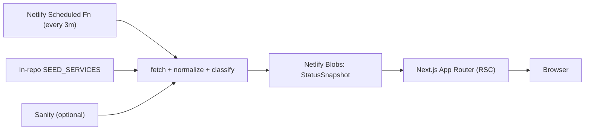

# TCS Repair Services Status

A fast, high-clarity status dashboard for the third-party services TCS Repair depends on.
It answers "is anything broken or degraded right now?" at a glance, surfaces active
incidents, and shows scheduled maintenance without letting it overwhelm the service health view.

- **Live:** https://status.tcs.repair (also https://tcs-status-page.netlify.app)
- **Status API:** https://status.tcs.repair/api/status
- **Studio:** optional — `/studio` when a Sanity project is configured

## Architecture



- **Next.js 16 (App Router) + React 19 + TypeScript** on **Netlify** (OpenNext plugin).
- **Service config** comes from in-repo [`src/lib/status/config.ts`](src/lib/status/config.ts) by default.
  Optional **Sanity** can override services, settings, and manual incidents when `NEXT_PUBLIC_SANITY_PROJECT_ID` is set.
- A **Netlify Scheduled Function** polls all feeds every ~3 minutes, normalizes them, and writes a
  single snapshot to **Netlify Blobs**. The page reads that snapshot (no per-request fan-out to 20+
  upstream status pages). If no Blob exists (local dev / cold start) it computes on demand.
- **MUI v9** dark theme; Server Components by default with minimal client JS for filters/accordions.

### Status model

Feeds (RSS/Atom, Atlassian Statuspage, Heroku API, manual) are normalized into a typed
`StatusSnapshot` (`src/lib/status/types.ts`). Color is never the only signal — every state pairs a
color with an icon and label.

| Tone                | Meaning                                            |
| ------------------- | -------------------------------------------------- |
| Green (operational) | No recent incident, no active maintenance          |
| Yellow (degraded)   | Incident within the recent window (default 24h)    |
| Red (outage)        | Active outage or very recent incident (default 3h) |
| Blue (maintenance)  | Scheduled or active maintenance                    |
| Gray (unknown)      | Disabled, no data, or feed fetch failed            |

## Prerequisites

- **Node 24 LTS** (`.nvmrc` → `nvm use`)
- **pnpm 11** (via Corepack: `corepack enable`)

## Local development

```bash
nvm use            # Node 24
corepack enable    # pnpm 11
pnpm install
cp .env.example .env   # NEXT_PUBLIC_SITE_URL=https://status.tcs.repair (or http://localhost:3000)
pnpm dev               # http://localhost:3000
```

### Environment variables

| Variable                         | Scope  | Purpose                                                   |
| -------------------------------- | ------ | --------------------------------------------------------- |
| `NEXT_PUBLIC_SITE_URL`           | public | Canonical URL, OG tags, sitemap, robots                   |
| `NEXT_PUBLIC_SANITY_PROJECT_ID`  | public | Optional; empty = use in-repo seed config                 |
| `NEXT_PUBLIC_SANITY_DATASET`     | public | Sanity dataset (default `production`)                     |
| `NEXT_PUBLIC_SANITY_API_VERSION` | public | Sanity API version                                        |
| `SANITY_READ_TOKEN`              | server | Read token when Sanity dataset is private                 |
| `SANITY_REVALIDATE_SECRET`       | server | Guards `/api/revalidate` (Sanity webhook)                 |

> `NEXT_PUBLIC_*` values are inlined at **build time** — changing them on Netlify requires a rebuild.

## Scripts

| Command                     | Description                                                                              |
| --------------------------- | ---------------------------------------------------------------------------------------- |
| `pnpm dev`                  | Dev server                                                                               |
| `pnpm build` / `pnpm start` | Production build / serve                                                                 |
| `pnpm typecheck`            | `tsc --noEmit`                                                                           |
| `pnpm lint`                 | ESLint (flat config)                                                                     |
| `pnpm test`                 | Vitest unit tests                                                                        |
| `pnpm test:e2e`             | Playwright smoke tests                                                                   |
| `pnpm seed`                 | Seed Sanity (requires a configured project + write token)                                |
| `pnpm format`               | Prettier                                                                                 |

## Sanity (optional)

Schemas and `/studio` remain in the repo. With an empty project ID the app uses `SEED_SERVICES`
and `DEFAULT_SETTINGS`. When you create a personal Sanity project later, set the env vars and run
`pnpm seed`.

## Netlify

- Build: `pnpm build` with `@netlify/plugin-nextjs`; `NODE_VERSION = 24` (`netlify.toml`).
- `netlify/functions/update-status.ts` runs on a 3-minute schedule and writes the snapshot to Blobs.
- Security headers + CSP and `/studio` + `/api` noindex are set in `next.config.ts` `headers()`.
- Site: **tcs-status-page** · custom domain **status.tcs.repair**.

## Project structure

```
app/                     # App Router routes (page, api/status, api/revalidate, robots, sitemap, studio)
src/lib/status/          # types, config/seed, fetchers, classify, normalize, sanitize, snapshot, cache
src/lib/sanity/          # client + GROQ queries (optional)
src/sanity/schemaTypes/  # Sanity schemas
src/components/status/   # dashboard UI
src/theme/               # MUI theme + tokens
netlify/functions/       # scheduled aggregator
scripts/seed-sanity.ts   # seeding
```

## Troubleshooting

- **Page shows seed logos from `/images`:** expected when Sanity is unconfigured.
- **A service is missing/extra incidents:** tune that service's patterns in `src/lib/status/config.ts`
  (or in Studio once Sanity is connected). Disabled services are excluded; hidden services are
  fetched but not shown.
- **Stale data on prod:** the page serves the cached Blob (refreshed every 3 min). Trigger
  `/api/revalidate` to refresh immediately when a revalidate secret is configured.
